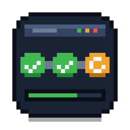
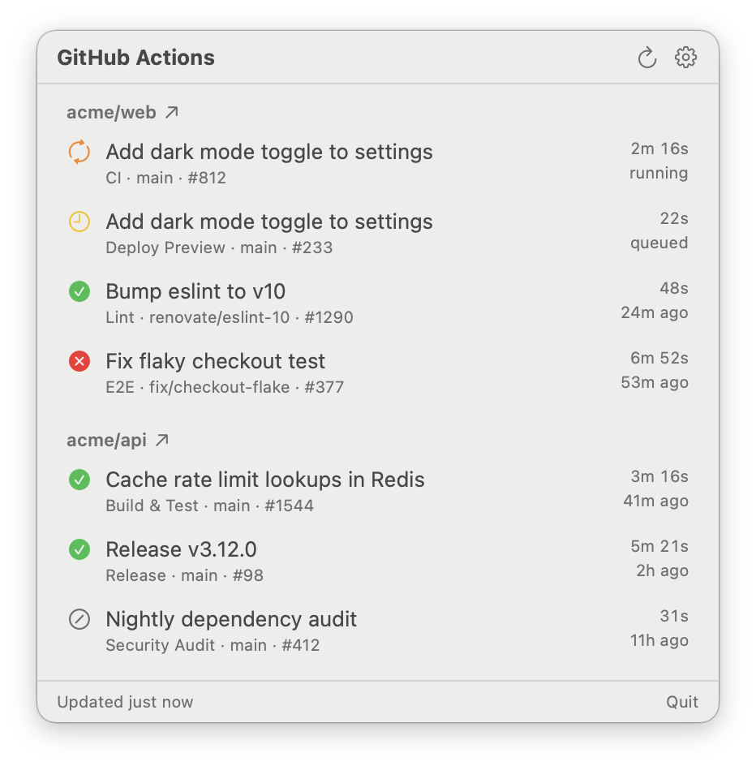

<p align="center">
  
</p>

<h1 align="center">Actions Tray</h1>

<p align="center">
  Watch GitHub Actions runs from your macOS menu bar, without keeping a browser tab open.
</p>

<p align="center">
  <picture>
    <source media="(prefers-color-scheme: dark)" srcset="docs/screenshot-dark.png">
    
  </picture>
</p>

## Menu bar icon

The icon shows the combined state of every repository you watch, so you can tell how CI is doing without opening anything. Running beats failed, and failed beats waiting for approval.

| Icon | Meaning |
| :---: | --- |
| <picture><source media="(prefers-color-scheme: dark)" srcset="docs/tray/idle-dark.png"></picture> | No data yet: no repositories added, or the first refresh hasn't finished. |
| <picture><source media="(prefers-color-scheme: dark)" srcset="docs/tray/passing-dark.png"></picture> | All good. The latest run of every workflow passed (or was skipped or cancelled). |
| <picture><source media="(prefers-color-scheme: dark)" srcset="docs/tray/running-dark.png"></picture> | Runs are queued or in progress. The number is how many. |
| <picture><source media="(prefers-color-scheme: dark)" srcset="docs/tray/failed-dark.png"></picture> | A workflow's latest run failed. |
| <picture><source media="(prefers-color-scheme: dark)" srcset="docs/tray/approval-dark.png"></picture> | A run is waiting for approval, such as a protected environment deployment. |

## Features

- **Status at a glance.** The [menu bar icon](#menu-bar-icon) changes color and shape for running, failed and waiting runs, with a count of active runs.
- **A board per repository.** Every workflow's latest run plus anything still in progress, with branch, run number, live duration and age.
- **Notifications** when runs finish: all of them, failures only, or none. Clicking one opens the run.
- **Quick actions.** Click a run to open it on GitHub; right-click to copy its link, cancel it, or re-run failed jobs.
- **Light on the API.** Polls every 5 seconds by default using conditional requests, which don't count against GitHub's rate limit when nothing changed.
- **No setup if you use the GitHub CLI.** It picks up your `gh` login automatically.

## Install

Requires macOS 15 or later.

### Download

1. Grab `ActionsTray-<version>.zip` from the [latest release](../../releases/latest) and move `ActionsTray.app` to `/Applications`.
2. The app isn't notarized, so macOS blocks the first launch. Either open it, then go to **System Settings → Privacy & Security** and click **Open Anyway**, or clear the quarantine flag:

   ```sh
   xattr -dr com.apple.quarantine /Applications/ActionsTray.app
   ```

### Build from source

Requires Xcode 26 or later.

```sh
git clone <this repo>
cd actions-tray
scripts/build-app.sh --install
```

This builds a universal (Apple silicon + Intel) app, copies it to `/Applications` and launches it. Without `--install` the app is left in `build/`.

## Usage

Click the icon in the menu bar, open **Settings** (gear icon) and add repositories as `owner/repo` or by pasting a GitHub URL.

### Authentication

Actions Tray looks for a token in this order:

1. A personal access token saved in Settings (stored in your Keychain).
2. The GitHub CLI: if you've run `gh auth login`, there's nothing else to do.

A [fine-grained token](https://github.com/settings/personal-access-tokens/new) needs **Actions: read** on the repositories you watch, or **Actions: read and write** to cancel and re-run from the app. A classic token needs the `repo` scope for private repositories.

The token is only ever sent to `api.github.com`.

### Settings

| Setting | Default |
| --- | --- |
| Refresh interval | 5 seconds |
| Notifications | All finished runs |
| Launch at login | Off (works when the app is in `/Applications`) |

## Development

```sh
swift build                    # debug build
scripts/build-app.sh           # release app bundle in build/
swift scripts/make-icon.swift  # regenerate the pixel-art icon
```

The app is a SwiftPM executable using SwiftUI's `MenuBarExtra`; `scripts/build-app.sh` wraps it into an app bundle with an ad-hoc signature.

Pushing a `v*` tag builds the app and publishes a GitHub release with the zipped bundle.

## License

[MIT](LICENSE)
